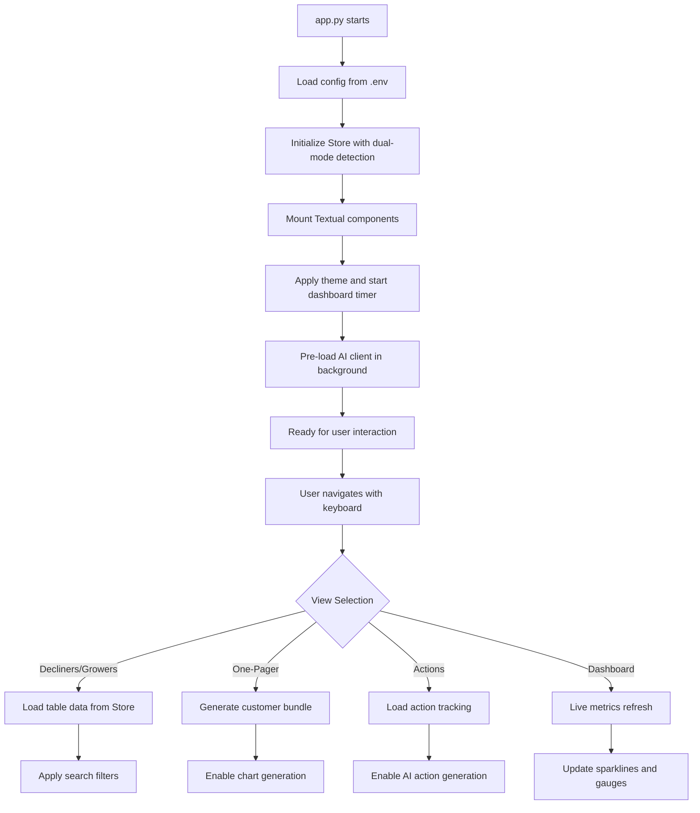
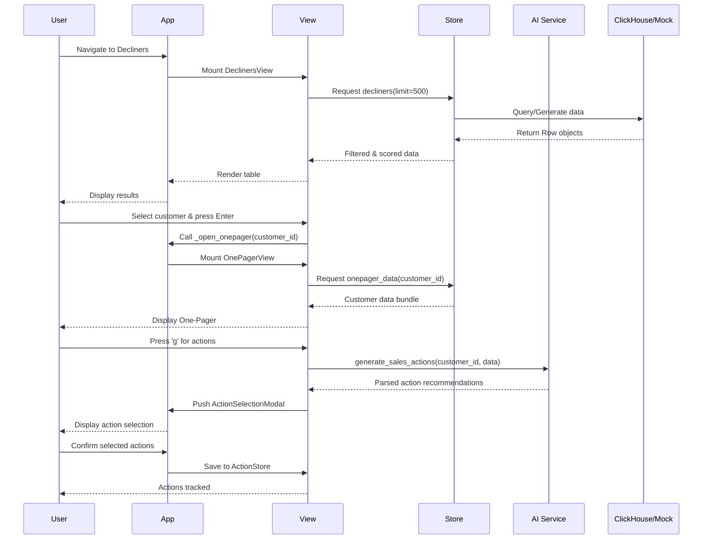
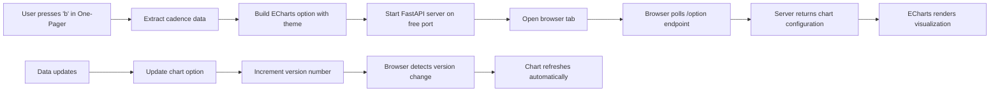

# Sales Insight TUI - Technical Documentation

## Overview

Sales Insight TUI is a sophisticated Python-based terminal user interface application built with Textual for year-over-year (YoY) sales analysis. The application provides real-time dashboards, interactive data exploration, AI-powered insights, and browser-based chart visualization for sales performance analysis.

## System Architecture

### Core Architecture Pattern

```
┌─────────────────────────────────────────────────────────────────┐
│                         Application Layer                        │
│  ┌─────────────┐ ┌─────────────┐ ┌─────────────┐ ┌─────────────┐│
│  │   app.py    │ │  themes.py  │ │ config.py   │ │ chart*.py   ││
│  │(Main TUI)   │ │(Theming)    │ │(Config)     │ │(Charts)     ││
│  └─────────────┘ └─────────────┘ └─────────────┘ └─────────────┘│
└─────────────────────────────────────────────────────────────────┘
                              │
                              ▼
┌─────────────────────────────────────────────────────────────────┐
│                         View Layer                              │
│  ┌─────────────┐ ┌─────────────┐ ┌─────────────┐ ┌─────────────┐│
│  │dashboard.py │ │decliners.py │ │onepager.py  │ │ actions.py  ││
│  │growers.py   │ │ai_modal.py  │ │formulas.py  │ │action_*.py  ││
│  └─────────────┘ └─────────────┘ └─────────────┘ └─────────────┘│
└─────────────────────────────────────────────────────────────────┘
                              │
                              ▼
┌─────────────────────────────────────────────────────────────────┐
│                      Service Layer                              │
│  ┌─────────────┐ ┌─────────────┐ ┌─────────────┐ ┌─────────────┐│
│  │    ai.py    │ │ai_client.py │ │  store.py   │ │models/*.py  ││
│  │(Async AI)   │ │(Sync AI)    │ │(Data Layer) │ │(Data Models)││
│  └─────────────┘ └─────────────┘ └─────────────┘ └─────────────┘│
└─────────────────────────────────────────────────────────────────┘
                              │
                              ▼
┌─────────────────────────────────────────────────────────────────┐
│                        Data Layer                               │
│  ┌─────────────┐ ┌─────────────┐ ┌─────────────┐ ┌─────────────┐│
│  │ Mock Data   │ │ ClickHouse  │ │actions.json │ │Browser Chart││
│  │(Synthetic)  │ │(Production) │ │(Tracking)   │ │(FastAPI)    ││
│  └─────────────┘ └─────────────┘ └─────────────┘ └─────────────┘│
└─────────────────────────────────────────────────────────────────┘
```

### Key Components

#### 1. Application Core (`app.py`)
- **Framework**: Built on Textual TUI framework
- **Layout**: Permanent dashboard (top 35%) + tabbed content (bottom 65%)
- **Navigation**: Left sidebar with 6 main views
- **Theme System**: Dynamic CSS-based theming (mono, matrix, light)
- **Real-time Updates**: Live dashboard refreshes every 1.5 seconds

#### 2. Data Layer (`store.py`)
- **Dual-mode Operation**: Mock data for development, ClickHouse for production
- **Data Model**: `Row` dataclass with customer metrics
- **Priority Algorithm**: Custom scoring combining absolute decline, percentage decline, and strategic importance
- **Mock Data Generation**: Deterministic synthetic data using `random.Random(42)` for consistent testing

#### 3. View Components (`/views/`)
- **Dashboard**: Real-time metrics with sparklines, gauges, and trend visualization
- **Decliners/Growers**: Searchable data tables with priority scoring
- **One-Pager**: Comprehensive customer analysis (headline, PVM, returns, geography, cadence)
- **Actions**: AI-generated sales action tracking and management
- **Modals**: AI interaction, formula display, action selection

#### 4. Services Layer (`/services/`)
- **AI Integration**: Dual client architecture for flexible LLM connectivity
- **Chart Generation**: ECharts option builders with theme awareness
- **Configuration**: Environment-based configuration with `.env` support

## LLM Integration & Architecture

### LLM Stack Configuration

The application supports **llama.cpp with Llama 3.2-1B** models through a dual-client architecture:

#### Primary AI Client (`services/ai.py`)
```python
# Async HTTP client optimized for performance
class AIClient:
    def __init__(self, base_url="http://localhost:8080/v1", 
                 model="Meta-Llama-3-8B-Instruct-Q5_K_M"):
        self._client = httpx.AsyncClient(
            timeout=httpx.Timeout(120.0),
            limits=httpx.Limits(max_keepalive_connections=2),
            http2=False,
            verify=False  # For localhost connections
        )
```

#### Fallback AI Client (`services/ai_client.py`)
```python
# Sync requests client with completion fallback
class LLMClient:
    def chat(self, messages, temperature=0.2, max_tokens=120)
```

### LLM Server Integration

```bash
# Start llama.cpp server
./server -m models/Meta-Llama-3.2-1B-Instruct-Q4_K_M.gguf \
         --port 8080 \
         --host localhost \
         --ctx-size 2048 \
         --n-predict 512 \
         --threads 4
```

#### Environment Configuration
```bash
# .env configuration
AI_BASE_URL=http://localhost:8080/v1
AI_MODEL=Meta-Llama-3-8B-Instruct-Q5_K_M
AI_API_KEY=sk-local
AI_PROVIDER=local
```

### Prompting Strategy

#### 1. Sales Action Generation
```python
# System prompt for sales analysts
system_prompt = (
    "You are a senior sales analyst. Based on customer performance data, "
    "provide at least 3 specific, actionable recommendations that a sales team can implement immediately. "
    "Focus on practical actions like pricing adjustments, targeted outreach, product positioning, "
    "inventory management, or relationship building. Be concise and specific. "
    "Format as a numbered list with brief, actionable statements."
)

# Context-aware user prompt
user_prompt = f"""
Customer: {customer_id}
Current Year Sales: ${cy_sales:,.0f}
Previous Year Sales: ${py_sales:,.0f}
YoY Change: ${yoy_delta:,.0f} ({yoy_pct:+.1f}%)
Performance: {performance_context}

Generate specific sales actions for this {performance_context} customer.
"""
```

#### 2. Root Cause Analysis
```python
# System prompt for analytical insights
sys = (
    "You are a retail analytics copilot. "
    "Data lives in ClickHouse; when proposing insights, include ClickHouse SQL that can reproduce the metric. "
    "Use the PVM (Price/Volume/Mix), returns, cadence, and geo frames. "
    "Output sections: Summary, Root-Cause Tags, Recommended Actions, SQL."
)
```

#### 3. Performance Optimizations for current GPU/hardware limitations
- **Zero Temperature**: `temperature=0.0` for consistent, fast responses
- **Limited Tokens**: `max_tokens=400` for focused output
- **Minimal System Prompts**: Only add when necessary (>10 chars)
- **Connection Pooling**: Persistent HTTP connections with keep-alive
- **Async Processing**: Non-blocking UI with background LLM calls

## Code Flow & Component Interactions

### Application Lifecycle



### Data Flow Pattern



### Theme System Implementation

#### Dynamic CSS Application
```python
def _apply_theme(self) -> None:
    # Remove old theme classes
    for cls in ("theme-mono", "theme-matrix", "theme-light"):
        self.remove_class(cls)
    
    # Apply new theme class - CSS handles the rest
    self.add_class(f"theme-{self.theme_name}")
    
    # Update the permanent dashboard theme
    if hasattr(self, 'dashboard'):
        self.dashboard.update_theme(self.theme_name)
```


### Chart Integration Workflow



## Workflow Documentation

### User Journey Mapping

#### Primary Workflow: Sales Analysis
1. **Launch Application**: `python app.py`
2. **Dashboard Overview**: Live metrics with trend visualization
3. **Identify Decliners**: Navigate to Decliners view, search/filter
4. **Deep Dive Analysis**: Enter on customer → One-Pager view
5. **Generate Actions**: Press 'g' → AI generates recommendations
6. **Track Actions**: Select actions → Added to Actions view
7. **Visualize Trends**: Press 'b' → Browser chart opens
8. **Monitor Progress**: Actions view shows tracking status

#### Navigation Patterns
```
Keyboard Shortcuts:
├── ESC              → Quit application (ONLY way to exit)
├── ↑/↓              → Navigate sidebar menu
├── Enter            → Select view or open One-Pager
├── /                → Focus search input
├── t                → Cycle themes (mono → matrix → light)
├── r                → Refresh current view
├── f                → Show formula modal
├── b                → Open browser chart (One-Pager only)
├── g                → Generate AI actions (One-Pager only)
├── u                → Update action status (Actions view)
└── Del              → Delete action (Actions view)
```

### Modal Interactions

#### AI Modal Workflow
```python
# User presses hotkey → Modal opens
class AIModal(ModalScreen):
    def on_mount(self) -> None:
        self.query_one("#ai_input", Input).focus()  # Auto-focus input
    
    def on_input_submitted(self, event) -> None:
        self._kickoff(event.value.strip())  # Submit prompt
    
    async def _async_request(self, prompt, log) -> None:
        client = await ensure_client_ready()  # Get AI client
        text = await client.ask(prompt, system=SQL_SYSTEM)  # Query LLM
        log.clear()
        log.write(text or "(empty response)")  # Display result
```

#### Action Selection Modal
```python
class ActionSelectionModal(ModalScreen):
    def _parse_actions(self, actions_text) -> List[str]:
        # Parse numbered lists: "1. Action item"
        # Parse bullet points: "• Action item"
        # Parse sentences for unstructured text
        # Return up to 6 actionable items
    
    def action_confirm(self) -> None:
        # Get selected checkboxes
        # Add to ActionStore with tracking
        # Return count to caller
```

### Background Processing

#### Dashboard Live Updates
```python
# Timer-based refresh every 1.5 seconds
def on_mount(self) -> None:
    self._timer = self.set_interval(self.refresh_seconds, self._tick)

def _tick(self) -> None:
    self._sample()  # Get new data points
    self.refresh()  # Update display
```

#### AI Client Preloading
```python
async def _preload_ai_client(self) -> None:
    """Pre-initialize AI client in background to eliminate first-use delay."""
    try:
        await ensure_client_ready()
        self._status("AI ready")
    except Exception:
        pass  # Silently fail if AI isn't available
```

## Technical Implementation Details

### Configuration Management

#### Environment Variables
```python
# config.py - Centralized configuration
@dataclass
class AppConfig:
    ch_url: str | None          # ClickHouse connection
    ch_user: str | None
    ch_pass: str | None
    ch_database: str | None
    ai_provider: str | None     # LLM provider
    ai_api_key: str | None      # API key
    ai_base_url: str | None     # Local server URL
    ai_model: str | None        # Model name
    
    @property
    def has_clickhouse(self) -> bool:
        return bool(self.ch_url and self.ch_user is not None)
```

#### Default Values
```python
# AI Service defaults
DEFAULT_BASE = "http://localhost:8080/v1"
DEFAULT_MODEL = "Meta-Llama-3-8B-Instruct-Q5_K_M"
DEFAULT_KEY = "sk-local"
```

### Data Models & Storage

#### Core Data Model
```python
@dataclass
class Row:
    customer_id: str
    cy_sales: float      # Current year sales
    py_sales: float      # Previous year sales
    yoy_delta: float     # Year-over-year delta
    yoy_pct: float       # Year-over-year percentage
    priority_score: float # Computed priority ranking
```

#### Priority Scoring Algorithm
```python
# Weighted priority calculation
w_strategic = py_sales / max_py if max_py else 0.0
w_absdrop = abs(yoy_delta) / max_absdelta if max_absdelta else 0.0
w_pctdrop = abs(yoy_pct) / max_abspct if max_abspct else 0.0
priority_score = (0.5 * w_absdrop) + (0.3 * w_pctdrop) + (0.2 * w_strategic)
```

#### Action Tracking Model
```python
@dataclass
class Action:
    action_id: str                      # UUID-based identifier
    customer_id: str                    # Associated customer
    description: str                    # AI-generated action text
    date_accepted: datetime            # Creation timestamp
    review_date: datetime              # Auto-calculated (6 weeks)
    status: ActionStatus               # WAITING/IN_PROGRESS/COMPLETE
```

#### JSON Persistence
```python
class ActionStore:
    def _save_to_file(self) -> None:
        """Save actions to actions.json with ISO datetime format."""
        data = [action.to_dict() for action in self._actions]
        with open(self._filename, 'w') as f:
            json.dump(data, f, indent=2)
```

### Performance Characteristics

#### Memory Usage
- **Mock Mode**: ~10MB baseline, ~50MB with full dataset (500 customers)
- **DB Mode**: ~15MB baseline + connection overhead
- **Chart Server**: +20MB when FastAPI server is active

- Will use on-command data pulls when utilizing real data to avoid memory usage.

#### Response Times
- **Dashboard Refresh**: <100ms (mock mode), <500ms (DB mode)
- **Table Loading**: <200ms (500 rows), includes filtering
- **AI Requests**: 2-5 seconds (depends on LLM server performance)
- **Chart Generation**: <1 second (browser opening + rendering)

#### Optimization Strategies
1. **Data Caching**: Store caches raw data to avoid repeated DB queries
2. **Lazy Loading**: Views only load data when mounted
3. **Connection Pooling**: HTTP client maintains persistent connections
4. **Minimal Redraws**: Textual's reactive system updates only changed components
5. **Background Processing**: AI requests don't block UI

### Error Handling Strategies

#### Graceful Degradation
```python
# AI service failure handling
try:
    client = await ensure_client_ready()
    text = await client.ask(prompt)
except Exception as e:
    self._status(f"AI service unavailable: {e}")
    # Application continues without AI features
```

#### Database Connection Fallback
```python
# ClickHouse connection handling
try:
    self.client = get_client(host=..., port=..., ...)
except Exception:
    self.client = None  # Fall back to mock mode
```

#### UI Error Recovery
```python
# View mounting protection
try:
    self.panel.mount(DeclinersView(...))
except Exception:
    self.panel.mount(Static("Error loading view"))
    self._status("View failed to load")
```

## Dependencies & Technology Stack

### Core Framework Dependencies
```
textual==0.58.1          # TUI framework
rich==14.1.0             # Text styling and formatting
```

### AI & LLM Integration
```
httpx==0.28.1            # Async HTTP client for AI requests
openai==1.98.0           # OpenAI-compatible API client
llama_cpp_python==0.3.16 # Python bindings for llama.cpp
ollama==0.5.1            # Ollama integration support
```

### Data Processing
```
pandas==2.3.1            # Data manipulation (optional)
numpy==2.2.6             # Numerical computing
clickhouse-connect       # ClickHouse database connector
```

### Chart & Visualization
```
fastapi==0.116.1         # Chart server API
uvicorn==0.35.0          # ASGI server for FastAPI
```

### Environment & Configuration
```
python-dotenv==1.1.1     # .env file loading
pydantic==2.11.7         # Data validation and settings
```

## Deployment & Operations

### Local Development Setup
```bash
# 1. Clone repository
git clone <repository-url>
cd sales-insight

# 2. Create virtual environment
python -m venv venv
source venv/bin/activate  # Linux/Mac
# venv\Scripts\activate   # Windows

# 3. Install dependencies
pip install -r requirements.txt

# 4. Configure environment
cp .env.example .env
# Edit .env with your settings

# 5. Start llama.cpp server (optional)
./llama-server -m model.gguf --port 8080

# 6. Run application
python app.py
```

### Production Considerations
1. **ClickHouse Integration**: Replace mock data with real SQL queries
2. **AI Server Scaling**: Use GPU acceleration for larger models
3. **Security**: Implement authentication for production deployments
4. **Monitoring**: Add logging and metrics collection
5. **Data Backup**: Implement action tracking data backup strategies

### Testing Strategy
- **Unit Tests**: Test data models and utility functions
- **Integration Tests**: Test AI client connectivity and database operations
- **UI Tests**: Use Textual's testing framework for view interactions
- **Performance Tests**: Benchmark with large datasets and concurrent users

## Future Enhancement Roadmap

### Phase 1: Core Improvements
- [ ] Enhanced search capabilities with fuzzy matching
- [ ] Export functionality for reports and charts
- [ ] Enhanced formula documentation with examples

### Phase 2: AI Enhancement
- [ ] Multi-model support (Llama 3.2-3B, OpenAI GPT-4)
- [ ] Contextual prompting with conversation memory
- [ ] Automated root cause analysis
- [ ] Predictive sales forecasting

### Phase 3: Enterprise Features
- [ ] Multi-user authentication and authorization
- [ ] Role-based access control
- [ ] Audit logging and compliance features
- [ ] Advanced ClickHouse query optimization
- [ ] Real-time data streaming

### Phase 4: Advanced Analytics
- [ ] Machine learning integration for pattern detection
- [ ] External data source integration (market data, news feeds)
- [ ] Advanced statistical analysis tools
- [ ] Custom dashboard builder

## Conclusion

Sales Insight TUI represents a sophisticated approach to terminal-based business analytics, combining modern Python frameworks with AI capabilities to deliver a powerful, keyboard-driven interface for sales analysis. The application's dual-mode architecture, comprehensive theming system, and integrated AI features make it a robust tool for sales teams and business analysts.

The technical architecture emphasizes performance, maintainability, and extensibility, with clear separation of concerns and graceful degradation strategies. The LLM integration provides intelligent insights while maintaining responsive user experience through asynchronous processing and connection pooling.

This documentation serves as a comprehensive technical reference for developers, system administrators, and stakeholders involved in the deployment, maintenance, and enhancement of the Sales Insight TUI application.
